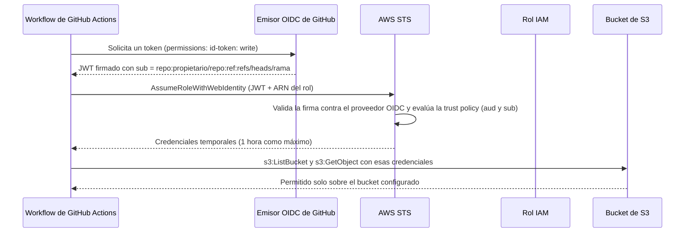

# GitHub Actions con OIDC hacia AWS

Módulo de Terraform que permite a un workflow de GitHub Actions obtener credenciales temporales de AWS sin guardar llaves de acceso estáticas. Crea el proveedor OIDC de GitHub en la cuenta y un rol IAM de mínimo privilegio que solo puede asumir un repositorio y una rama concretos.

## Objetivo

- Eliminar `AWS_ACCESS_KEY_ID` y `AWS_SECRET_ACCESS_KEY` de los secretos del repositorio.
- Limitar quién puede asumir el rol (repositorio y rama) y qué puede hacer (solo lectura de un bucket).
- Dejar un workflow de prueba que demuestra tanto el acceso permitido como el denegado.

## Arquitectura

Flujo de confianza entre GitHub y AWS:



La confianza se define en dos lugares:

1. El proveedor OIDC registra a `token.actions.githubusercontent.com` como emisor de identidades válido en la cuenta.
2. La trust policy del rol exige `aud = sts.amazonaws.com` y `sub = repo:<repositorio>:ref:refs/heads/<rama>`. Un token de otro repositorio o de otra rama es rechazado aunque venga de GitHub.

## Componentes

| Recurso | Archivo | Función |
| --- | --- | --- |
| `aws_iam_openid_connect_provider.github` | `terraform/main.tf` | Registra el emisor OIDC de GitHub en la cuenta. |
| `aws_iam_role.github_actions` | `terraform/main.tf` | Rol que asumen los workflows; sesión de 1 hora como máximo. |
| `aws_iam_role_policy.lectura_bucket` | `terraform/main.tf` | Permisos `s3:ListBucket` y `s3:GetObject` sobre un solo bucket. |
| Workflow de prueba | `.github/workflows/main.yml` | Asume el rol, lista el bucket permitido y comprueba que `aws s3 ls` general falla. |
| CI de Terraform | `.github/workflows/ci-terraform.yml` | `fmt`, `validate`, tflint y Checkov en cada cambio de `terraform/`. |

## Requisitos

- Terraform `>= 1.9.0, < 2.0.0` y proveedor AWS `~> 5.80.0`.
- Credenciales de AWS con permisos para crear proveedores OIDC y roles IAM (solo para el despliegue inicial, desde tu equipo).
- Un bucket de S3 existente sobre el que el rol tendrá lectura.
- Un repositorio de GitHub que usará el rol.

## Variables

| Variable | Descripción | Valor por defecto |
| --- | --- | --- |
| `repositorio` | Repositorio autorizado, con formato `propietario/nombre`. | Sin valor, es obligatoria |
| `rama` | Rama autorizada a asumir el rol. | `main` |
| `bucket_lectura` | Bucket sobre el que el rol tiene solo lectura. | Sin valor, es obligatoria |
| `nombre_rol` | Nombre del rol IAM. | `github-actions-lectura-s3` |
| `region` | Región de AWS. | `us-east-1` |

## Despliegue

```bash
cd terraform
cp terraform.tfvars.example terraform.tfvars   # ajusta repositorio, rama y bucket_lectura
terraform init
terraform plan
terraform apply
terraform output arn_rol
```

Después:

1. En el repositorio de GitHub, crea la variable `AWS_ROLE_ARN` (Settings, Secrets and variables, Actions, pestaña Variables) con el valor de `arn_rol`. No es un secreto: el ARN solo sirve si el token cumple la trust policy.
2. Ejecuta el workflow "Prueba de acceso a AWS con OIDC" desde la pestaña Actions e indica el nombre del bucket.

El workflow pasa si `aws sts get-caller-identity` y `aws s3 ls s3://<bucket>/` funcionan y si `aws s3 ls` sin bucket falla con acceso denegado.

## Cómo adaptarlo

- **Otra rama o varias**: cambia `rama`. Para varias ramas, usa `StringLike` con un patrón como `repo:propietario/repo:ref:refs/heads/release/*` en la condición `sub` de `main.tf`.
- **Un entorno de GitHub**: si el job usa `environment: produccion`, el `sub` pasa a ser `repo:propietario/repo:environment:produccion`.
- **Pull requests**: el `sub` de un PR es `repo:propietario/repo:pull_request`. Conviene un rol distinto, con permisos aún menores, para ese caso.
- **Otros permisos**: edita `data.aws_iam_policy_document.lectura_bucket` manteniendo recursos concretos en lugar de `*`.
- **Proveedor ya existente**: la cuenta admite un solo proveedor por URL. Si ya existe, impórtalo con `terraform import aws_iam_openid_connect_provider.github <arn>` antes de aplicar.

## Costos aproximados

El proveedor OIDC, el rol IAM y las llamadas a STS no tienen costo. Solo se paga el uso normal de S3 que haga el workflow (por solicitud y almacenamiento del bucket existente), que en esta prueba es de centavos o menos.

## Limpieza

```bash
cd terraform
terraform destroy
```

Esto elimina el rol y el proveedor OIDC. El bucket no lo gestiona este módulo y no se toca.
